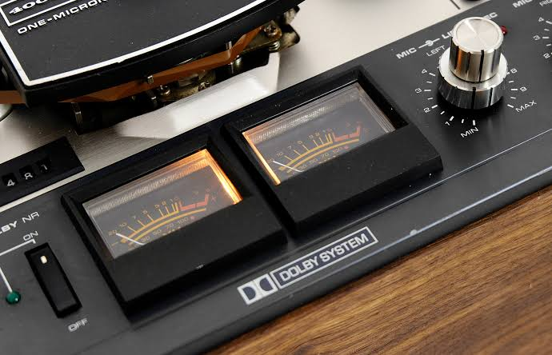

# Neural Amp guitar plugin — Akai 4000DB

Guitar plugin made with JUCE, using black-box modelling with neural networks to reproduce the pre-amp section of my old Akai 4000DB reel-to-reel tape machine.

Machine learning is used to train a model of the left (or mono) channel gain knob, using conditioned parameters for an accurate representation of the amplified tone in different configurations. 

<p align=center>
  <picture>
    
  </picture>
</p>

The training was made using the [GuitarML](https://github.com/GuitarML/Automated-GuitarAmpModelling) Automated Amp Modelling submodule with a multi-parameterization model. This repository is an implementation of the paper ["Real-Time Guitar Amplifier Emulation with Deep Learning"](https://www.mdpi.com/2076-3417/10/3/766/htm). Real-time processing within the plugin was achieved using [RTNeural](https://github.com/jatinchowdhury18/RTNeural), which is an inference engine highly optimized for audio applications.

Taking inspiration from Neural DSP products, the goal of the project is to develop a basic machine learning plugin in a similar fashion, to model a highly non-linear amplification circuit.

The model was trained at 44.1 kHz. At higher host sample rates, the plugin uses RTNeural's linearly interpolated recurrent sample-rate correction so the LSTM's time behavior remains tied to the training rate. The 44.1 kHz path uses an exact 1-sample recurrent delay. RTNeural does not support recurrent correction below the training rate, so lower host rates use the 44.1 kHz recurrence behavior.

A free VST3 plugin is available for trial in releases. Youtube demo:

<p align="center">
  <a href="https://www.youtube.com/watch?v=i5kTCFLeWxk">
    
  </a>
</p>


## Build

Requires CMake 3.22+ and a C++17 compiler; the diagnostics viewer also needs Python 3.9+.

Add JUCE to the workspace. The easiest way is to add it as a submodule:
```
git submodule add https://github.com/juce-framework/JUCE.git JUCE
git submodule update --init --recursive
```
**Important note:** depending on the system you want to build for, you'll also need to set the VST3 format accordingly on the `./CMakeLists.txt` file. I am on Windows so I will use `set(FORMATS VST3 Standalone)`, but for example if you want to compile for macOS, use `set(FORMATS AU VST3)` instead.

```
cmake -B cmake-build "-DCMAKE_POLICY_VERSION_MINIMUM=3.5"
cmake --build cmake-build --config Release
```

## Debug build with diagnostics

Build with profiling and launch the [DiagnosticsViewer](https://github.com/EnrcDamn/DiagnosticsViewer) tool:

```powershell
cmake -S . -B cmake-build "-DCMAKE_POLICY_VERSION_MINIMUM=3.5" -DDIAGNOSTICS=ON -DNEURALAMP_COPY_PLUGIN_AFTER_BUILD=ON
cmake --build cmake-build --config RelWithDebInfo --parallel
cmake --build cmake-build --target diagnostics_viewer
```

Run the VST3 in the DAW (or run the app in the adjacent `Standalone` folder) and select its session in the viewer.

`DIAGNOSTICS=AUTO` (default) enables Debug only.
